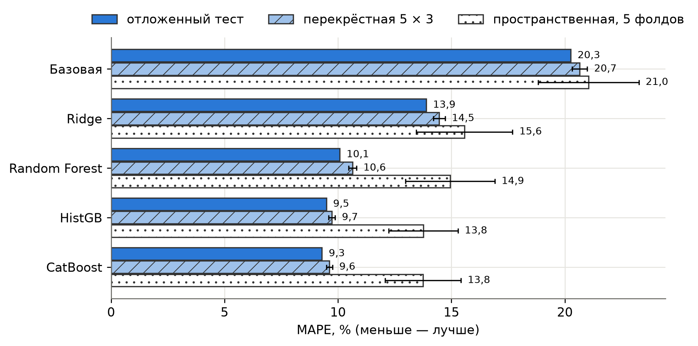
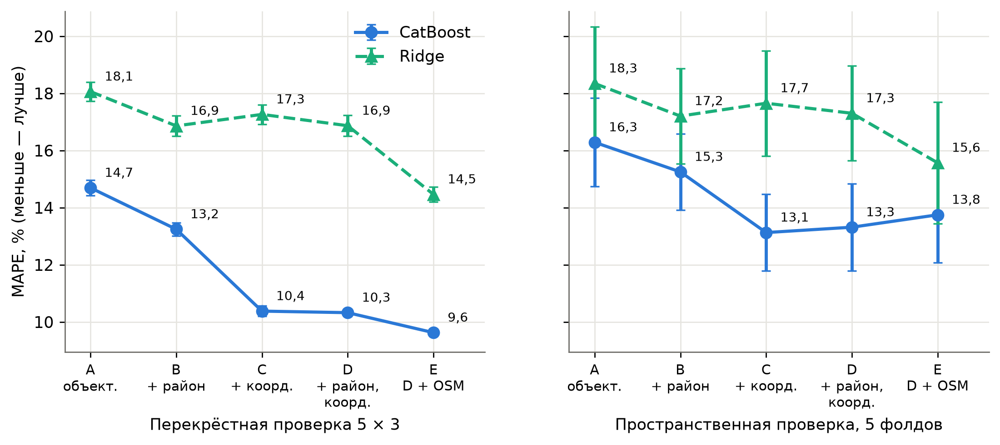
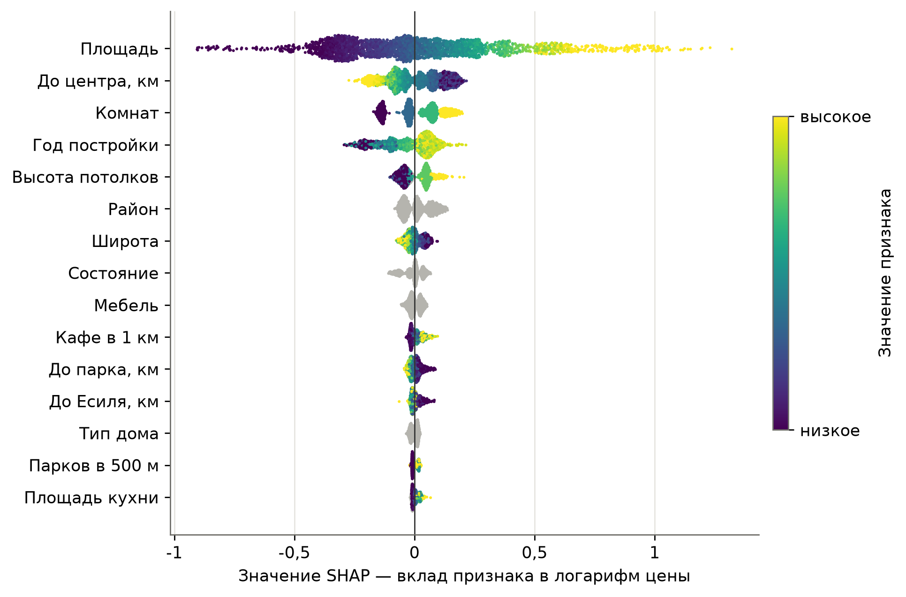
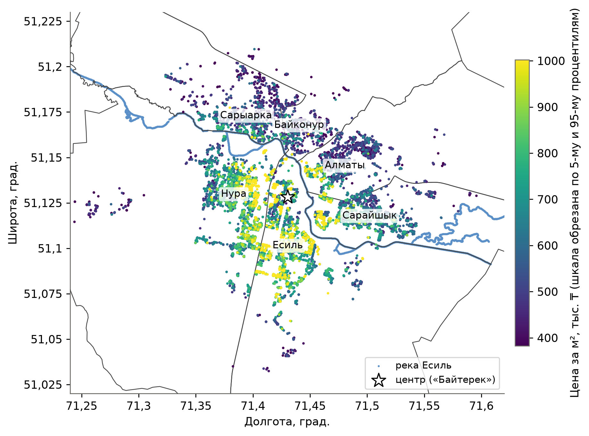

# Прогноз цен на квартиры в Астане по открытым данным

[](https://colab.research.google.com/github/WebDiyar/astana-housing-price-ml/blob/main/nirm3_experiment.ipynb)


> **Summary (EN).** A reproducible machine-learning pipeline that predicts apartment asking prices in Astana,
> Kazakhstan, from an open listing dataset (Kaggle, CC0, 18,388 listings, January 2026) enriched with
> OpenStreetMap features. Five approaches are compared under a hold-out test, repeated 5-fold and spatial
> cross-validation. The best model, CatBoost, reaches MAPE 9.29 % and R² 0.926 on the hold-out set.
> OpenStreetMap features reduce the error on random splits (MAPE 10.33 → 9.63 %) but not on spatially
> held-out areas (13.33 → 13.66 %).

Программная часть научно-исследовательской работы магистранта на тему «Разработка модели прогнозирования цен
на недвижимость на основе анализа открытых данных».

**Автор:** Амангелді Дияр, Казахский университет технологии и бизнеса им. К. Кулажанова, образовательная
программа 7М06136 «Информационные системы», Астана, 2026.

## Что здесь есть

| Что | Где |
|---|---|
| Блокнот с полным расчётом и сохранёнными выводами | [`nirm3_experiment.ipynb`](nirm3_experiment.ipynb) |
| Конвейер: загрузка, очистка, геопризнаки, модели, проверка, интерпретация | [`src/`](src) |
| Прототип оценки одной квартиры (функция и командная строка) | [`predict.py`](predict.py) |
| Автотесты, 42 шт. | [`tests/`](tests) |
| Исходные и обработанные данные с описанием | [`data/`](data), [`data/README.md`](data/README.md) |
| Таблицы результатов (CSV, JSON), 52 файла | [`results/`](results) |
| Рисунки, 18 шт., PNG 250 dpi | [`figures/`](figures) |
| Обученная модель | [`models/price_model.joblib`](models/price_model.joblib) |

## Вопросы исследования

1. Какая модель точнее прогнозирует цену предложения квартиры?
2. Что добавляют открытые геоданные OpenStreetMap к признакам объявления, району и координатам?
3. Какие признаки определяют прогноз и на каких квартирах модель ошибается сильнее?

## Данные

| Источник | Лицензия | Объём |
|---|---|---|
| [Astana Real Estate 2025](https://www.kaggle.com/datasets/muraraimbekov/astana-real-estate-2025) (Kaggle, автор набора — Murat Raimbekov): объявления о продаже квартир, собранные 03–06.01.2026 | CC0 | 18 388 строк × 37 столбцов; после очистки — 16 779 |
| [OpenStreetMap](https://www.openstreetmap.org/copyright) через Overpass API: школы, детские сады, медицина, вузы, торговые центры, супермаркеты, аптеки, кафе, остановки, парки, русло Есиля, границы районов | ODbL 1.0 | 2 960 объектов, запрос 26.11.2026 |

Цель — цена предложения в тенге (модель учится на её логарифме). Цена в долларах и цена за квадратный метр
в признаки не входят: обе получены из цели. Признаков 64: 28 из объявления, 3 локационных (район, широта,
долгота) и 33 рассчитанных по OpenStreetMap (расстояния до ближайших объектов, число объектов в радиусе 500 м
и 1 км, расстояние до центра и до реки).

Правила очистки и число строк на каждом шаге записаны в [`results/cleaning_journal.csv`](results/cleaning_journal.csv),
описание признаков — в [`data/processed/feature_dictionary.csv`](data/processed/feature_dictionary.csv).

## Результаты

### Сравнение моделей

Отложенный тест — 3 356 объявлений (20 %), обучение — 13 423. Перекрёстная проверка — 5 фолдов × 3 повтора.
Пространственная проверка — 5 фолдов, каждая ячейка 2 × 2 км целиком в одном фолде. Для сравнения наборов D и E
она выполнена на двух сетках ячеек, исходной и сдвинутой на 1 км, что даёт 10 фолдов; в один и тот же фолд
в двух разбиениях попадает 26,2 % объявлений.

| Модель | MAE, млн ₸ (тест) | MAPE, % (тест) | R² (тест) | MAPE, % (перекрёстная) | MAPE, % (пространственная) |
|---|---:|---:|---:|---:|---:|
| Медиана цены за м² по району × площадь | 10,47 | 20,26 | 0,708 | 20,65 ± 0,34 | 21,04 ± 2,22 |
| Ridge | 7,41 | 13,89 | 0,830 | 14,46 ± 0,26 | 15,57 ± 2,13 |
| Random Forest | 5,27 | 10,08 | 0,908 | 10,65 ± 0,17 | 14,95 ± 1,96 |
| HistGradientBoosting | 4,96 | 9,49 | 0,923 | 9,73 ± 0,14 | 13,76 ± 1,52 |
| **CatBoost** | **4,87** | **9,29** | **0,926** | **9,63 ± 0,13** | 13,75 ± 1,67 |

Различия между моделями значимы: критерий Фридмана по 15 фолдам даёт p < 0,0001, все попарные сравнения по
критерию Уилкоксона с поправкой Холма — p = 0,0006.



### Вклад геоданных

Наборы признаков наращиваются по шагам, фолды и гиперпараметры при этом не меняются.

| Набор признаков | Признаков | CatBoost: перекрёстная | CatBoost: пространственная | Ridge: перекрёстная | Ridge: пространственная |
|---|---:|---:|---:|---:|---:|
| A — из объявления | 28 | 14,69 | 16,29 | 18,06 | 18,35 |
| B — A + район | 29 | 13,25 | 15,25 | 16,86 | 17,21 |
| C — A + координаты | 30 | 10,38 | 13,13 | 17,26 | 17,66 |
| D — A + район + координаты | 31 | 10,33 | 13,32 | 16,87 | 17,30 |
| E — D + признаки OpenStreetMap | 64 | 9,63 | 13,75 | 14,46 | 15,57 |

В таблице — MAPE, %.

- При случайном разбиении признаки OpenStreetMap снижают ошибку CatBoost с 10,33 до 9,63 %. Набор E точнее
  набора D во всех 15 фолдах, p = 0,0004.
- На новых местах выигрыша у CatBoost нет: на 10 пространственных фолдах MAPE меняется с 13,33 до 13,66 %,
  набор E точнее только в 3 фолдах, p = 0,084. MAE при этом растёт с 7,14 до 7,55 млн ₸: набор E точнее
  в 1 фолде из 10, p = 0,004.
- Линейной модели геопризнаки помогают в обеих схемах: 16,87 → 14,46 % при случайном разбиении и
  17,47 → 15,74 % на 10 пространственных фолдах (набор E точнее в 9 фолдах, p = 0,004).
- Оценка вклада геоданных зависит от схемы проверки: выигрыш, измеренный при случайном разбиении, не
  переносится на кварталы, которых не было в обучении. При случайном разбиении у 59,7 % тестовых объявлений
  дом встречается и в обучающей части.



### Что определяет прогноз

Доля признака в сумме средних модулей SHAP на тесте: площадь — 28,7 %, расстояние до центра — 10,0 %, число
комнат — 8,4 %, год постройки — 8,0 %, высота потолков — 5,3 %. Полный список —
[`results/shap_importance.csv`](results/shap_importance.csv).



### Где модель ошибается

- Дорогие квартиры: в верхнем ценовом квинтиле MAPE 11,89 %, цены занижаются в среднем на 3,5 %.
- Многокомнатные: от 7,92 % у однокомнатных до 12,59 % у пятикомнатных.
- Старый фонд: 10,93 % для домов до 1990 года против 8,80 % для домов 2020–2025 годов.
- Между районами разница мала: от 8,74 до 9,90 %.

Разбивка по сегментам — [`results/errors_by_segment.csv`](results/errors_by_segment.csv).



## Запуск

### Google Colab

Кнопка «Open in Colab» вверху открывает блокнот. Первая ячейка с кодом клонирует репозиторий и ставит
недостающие пакеты. Все выводы в блокноте уже сохранены, читать его можно без запуска. Полный пересчёт занимает
около 15 минут на компьютере с 10 ядрами; в Colab, где ядер меньше, он идёт дольше.

### Локально

```bash
git clone https://github.com/WebDiyar/astana-housing-price-ml.git
cd astana-housing-price-ml
python -m venv .venv && source .venv/bin/activate
pip install -r requirements.txt          # точные версии расчёта: requirements-lock.txt

python tests/run_tests.py                # 42 теста, около 20 секунд
python -m src.pipeline                   # данные -> очистка -> признаки -> models/price_model.joblib
jupyter nbconvert --to notebook --execute --inplace \
    --ExecutePreprocessor.timeout=-1 nirm3_experiment.ipynb     # полный расчёт
```

### Оценка одной квартиры

```bash
python predict.py --area 62 --rooms 2 --floor 7 --total-floors 12 --year 2019 \
    --house-type монолитный --lat 51.1283 --lon 71.4305
```

```text
Прогноз цены: 54.19 млн ₸ (874 тыс. ₸ за м²), район: Есиль
Интервал 80 %: 47.17 млн ₸ – 63.11 млн ₸; 90 %: 45.16 млн ₸ – 66.91 млн ₸
Модель: набор E, MAPE на тесте 9.29 %
Главные факторы (вклад в цену относительно среднего уровня):
  До центра, км            = 0.0            +18.6 %
  Год постройки            = 2019.0         +9.3 %
  Район                    = Есиль          +8.4 %
  Площадь                  = 62.0           -6.9 %
  Кафе в 1 км              = 64.0           +6.3 %
```

Обязательны площадь, число комнат, год постройки и либо координаты, либо район. Без координат работает вторая
модель, которой хватает района. Ключ `--json` выводит результат в JSON. То же из кода:

```python
from predict import predict

predict({"area": 62, "rooms": 2, "year_built": 2019, "latitude": 51.1283, "longitude": 71.4305})
```

## Структура

```
├── nirm3_experiment.ipynb    блокнот: данные -> модели -> абляция -> интерпретация -> ошибки -> прототип
├── predict.py                оценка одной квартиры
├── src/
│   ├── config.py             пути, seed, границы допустимых значений
│   ├── osm.py                запросы Overpass, разбор слоёв
│   ├── geo.py                расстояния, число объектов в радиусе, район по границам
│   ├── cleaning.py           очистка с журналом
│   ├── features.py           признаки и наборы A–E
│   ├── models.py             модели, пространства поиска, метрики
│   ├── validation.py         разбиения, перекрёстная и пространственная проверка, критерии
│   ├── analysis.py           перестановочная важность, SHAP, частная зависимость, ошибки по сегментам
│   └── pipeline.py           сквозной запуск и сборка модели
├── tests/                    автотесты unittest
├── data/raw/                 набор Kaggle и ответы Overpass без изменений
├── data/processed/           очищенный набор, словарь признаков, разбиение на обучение и тест
├── models/                   обученная модель
├── figures/                  рисунки
└── results/                  таблицы результатов
```

## Воспроизводимость

- Seed 42 задан в `src/config.py` и используется во всех разбиениях, моделях и перемешиваниях.
- Контрольный запуск блокнота на свежем клоне без кэша (27.11.2026) воспроизвёл все таблицы результатов:
  относительные расхождения не превышают 2,2e-13, отличаются только замеры времени
  ([`results/reproduction_check.json`](results/reproduction_check.json)).
- Версии расчёта: Python 3.13.2, numpy 2.5.3, pandas 3.0.6, scikit-learn 1.9.1, scipy 1.18.1, catboost 1.2.10,
  shap 0.54.1 — они же в `requirements-lock.txt`. Автотесты проходят и на Python 3.12 с numpy 2.0.2,
  pandas 2.2.2, scikit-learn 1.6.1.
- Ответы Overpass сохранены в `data/raw/osm/` вместе с текстами запросов и контрольными суммами. Повторный
  запрос (`python -m src.osm --force`) вернёт более свежее состояние карты, и геопризнаки могут немного
  измениться.
- Блокнот кэширует тяжёлые шаги в `data/processed/cache/` (в репозиторий не входит). Переменная
  `NIRM3_FORCE=1` пересчитывает всё заново.

## Ограничения

- Это цены предложения, а не сделок, и срез за четыре дня января 2026 года. Проверка на будущих периодах на
  таких данных невозможна.
- Набор собран третьим лицом, его полнота относительно всего рынка неизвестна.
- Координаты заданы с точностью до дома. Оценки на случайном тесте относятся к уже известным домам; для новых
  мест ориентир — пространственная проверка.
- Расстояния считаются по прямой. Полнота OpenStreetMap для Астаны не проверялась.
- Модель применима к квартирам площадью 15–300 м², до 6 комнат, с ценой 200 000–2 000 000 ₸ за м².
- Текст и фотографии объявлений не используются.

## Лицензии

- Код — [MIT](LICENSE).
- Набор объявлений — CC0, источник указан выше.
- Данные OpenStreetMap и рассчитанные по ним признаки — ODbL 1.0, © участники OpenStreetMap.

Подробнее — в [NOTICE.md](NOTICE.md).

## Как сослаться

Амангелді Д. Прогноз цен на квартиры в Астане по открытым данным: код и данные эксперимента. — 2026. —
URL: https://github.com/WebDiyar/astana-housing-price-ml
